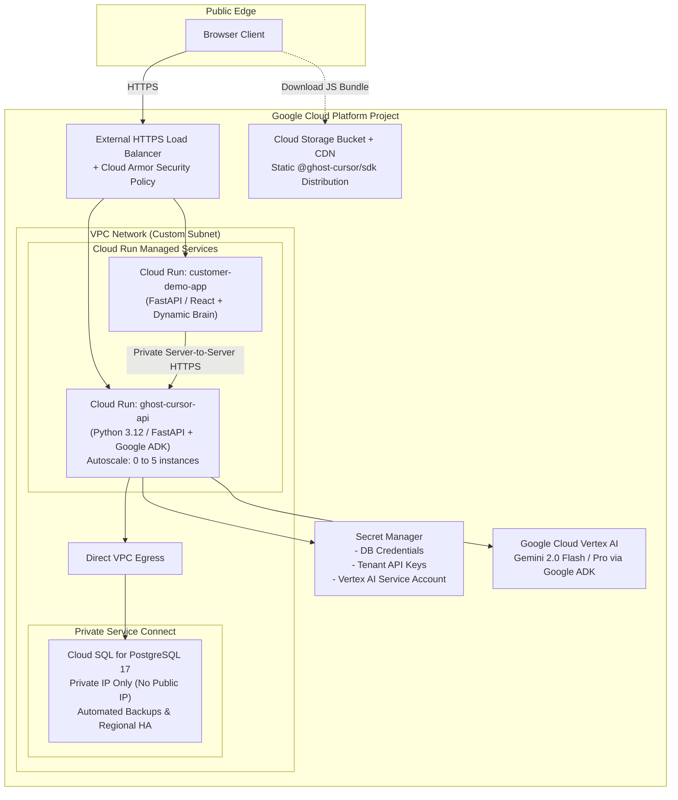

# 🚀 ACT.md — Master Technical Implementation Blueprint

> **Ghost Cursor: Application-Aware Autonomous AI Co-pilot as a Service**
> *Consolidated single-source implementation guide synthesizing architectural directives, Google Agent Development Kit (ADK) orchestration, Vertex AI Gemini 2.0 integration, strict security boundaries, robust DOM synchronization, and dynamic Page-Brain resolution.*

---

## 1. Executive Product Architecture & Core Invariants

### 1.1 Non-Negotiable Integration Topology

Ghost Cursor strictly enforces **one and only one communication topology**:

```text
┌─────────────────────────────────────────────────────────────┐
│ Customer Web Application (User's Browser)                   │
│   ├── Host Application UI (React / Next.js / Vue / Vanilla) │
│   └── @ghost-cursor/sdk (DOM-aware executor & UI widget)    │
└──────────────────────────────┬──────────────────────────────┘
                               │ Same-origin request / WS
                               │ Existing user session & CSRF
                               ▼
┌─────────────────────────────────────────────────────────────┐
│ Customer Backend Gateway SDK (Python / Node.js)             │
│   ├── Validates customer user session                       │
│   ├── Injects Subject Identity (opaque ID)                  │
│   ├── Dynamic Brain Loader (platform.md + {page}.md)        │
│   └── Executes Local Read-Only Backend Tools                │
└──────────────────────────────┬──────────────────────────────┘
                               │ Server-to-Server HTTPS
                               │ X-Ghost-Subject + Bearer API Key
                               ▼
┌─────────────────────────────────────────────────────────────┐
│ Ghost Cursor Managed Cloud (GCP)                            │
│   ├── Cloud Run: Python 3.12 (FastAPI + Google ADK Engine)  │
│   ├── Google ADK Agent: Tool-calling with Gemini 2.0        │
│   ├── Cloud SQL: PostgreSQL 17 / Firestore (Run Storage)    │
│   └── Secret Manager: Tenant keys & model credentials       │
└─────────────────────────────────────────────────────────────┘

```

#### Absolute Boundary Invariants:

1. **Zero Browser-Direct Access:** The browser NEVER communicates directly with Ghost Cursor Cloud or any LLM provider. No API keys, secret tokens, or complete prompts reach client bundles.


2. **AI Selects Tools & Parameters; Frontend Deterministically Executes:** The LLM does not write custom code or raw DOM scripts. It receives fixed, typed tool definitions (e.g., `navigate`, `click`, `fill_input`, `guided_tour`, `clarify`). The agent calls the tool with validated parameters (`target_id`, `value`). The JSON containing the tool call parameters is sent to the client, where the Frontend SDK deterministically executes it.


3. **Pure Business Context in Brain:** Markdown Brain files contain **zero HTML tags or DOM selectors**. They contain plain English business rules, field constraints, platform definitions, and domain logic.


4. **Dynamic Page-Brain Resolution:** The Backend SDK automatically loads `platform.md` (global platform context) plus `{page}.md` (page-specific context) based on the client's current route.


5. **Local Tools are Read-Only:** Server tools run during orchestration are read-only (e.g., simulations, balance checks, ROI calculators). Mutating operations occur solely on the client DOM via approved UI actions.


6. **Approval-First Execution:** Mutating or multi-step action sequences require explicit user confirmation ("Approve and Run") prior to execution.


7. **Customer Data Sovereignty (Stateless Cloud Engine):** Ghost Cursor Cloud is a stateless reasoning orchestrator that does not persist conversational chats or personal customer records. Chat session records, message histories, and execution audits are persisted exclusively in the customer's own database using SDK-provided schemas.


---

## 2. Security Boundaries, Protocols & State Management

### 2.1 Primitive Constraints & Request Sizing

To prevent denial-of-service and injection vectors across all interfaces:

* **Protocol Version:** Literal string `"1"`.


* **Logical IDs:** Strings containing 1–120 characters matching `^[a-zA-Z0-9_.:-]+$`.


* **Run / Request / Event IDs:** Standard RFC 4122 UUIDs.


* **Scalars:** String at most 2,000 characters, finite number, or boolean.


* **Subject Asserted by Gateway:** Opaque string matching `^[a-zA-Z0-9_.:@-]+$` injected via the server-to-server header `X-Ghost-Subject` (never parsed from browser request JSON).


* **Payload Bounds:** Maximum hosted request body capped at **64 KiB**; local tool outputs bounded to **16,000 characters**; maximum Brain context bounded to **32,000 characters**.


### 2.2 Multi-Turn Run State Machine & Deduplication

To guarantee resilience across dropped connections and slow inference passes:

* **Run Expiry & Turn Bounds:** Runs expire automatically after **30 minutes**; any subsequent attempt to continue an expired run returns HTTP `410 Gone`. Continuation turns are capped at **12 turns** per run.


* **Revision Matching & Replay Protection:** Every request enforces strict optimistic concurrency. If a client attempts to continue an un-updated revision, or changes a request payload under an identical `requestId`/`eventId`, the server rejects the request with HTTP `409 Conflict`.


* **Discrete Plan Rules:** Within any single model turn, only **ONE** of `questions`, `actions`, or `toolCalls` may be non-empty. An empty array across all three indicates terminal plan completion.


* **Canary Leak Detection Filter:** All internal Brain documents embed a private test canary marker:
```text
GHOST_BRAIN_SERVER_ONLY_CANARY_2026

```


The Customer Gateway interceptor scans all outgoing responses destined for the browser; if the canary string is present, the gateway blocks the response immediately to prevent exfiltration.


---

## 3. Tool-Calling Agent Architecture: Frontend Executors as Agent Tools

### 3.1 The Concept & How It Works

Instead of having the model output a freeform text plan, the Google ADK Agent is provided with a fixed set of **Frontend Action Tools** and **Backend Knowledge Tools**.

```text
┌────────────────────────────────────────────────────────────────┐
│ GOOGLE ADK AGENT IN PYTHON (Cloud Run)                         │
│                                                                │
│  Tools Provided to Agent:                                      │
│  ├── [Frontend Action Tool] navigate(target_page)              │
│  ├── [Frontend Action Tool] click(target_id)                   │
│  ├── [Frontend Action Tool] fill_input(target_id, value)       │
│  ├── [Frontend Action Tool] select_option(target_id, option)   │
│  ├── [Frontend Action Tool] toggle_switch(target_id, state)    │
│  ├── [Frontend Action Tool] guided_tour(steps)                 │
│  ├── [Frontend Action Tool] ask_clarification(question, opts)  │
│  └── [Backend Read-Only Tool] calculate_roi(assumptions)       │
│                                                                │
│  Agent Reasons ➔ Outputs Tool Call JSON:                       │
│  { "tool": "click", "parameters": { "target_id": "theme.toggle" } }
└──────────────────────────────┬─────────────────────────────────┘
                               │ JSON Tool Call Parameters
                               ▼
┌────────────────────────────────────────────────────────────────┐
│ FRONTEND SDK EXECUTOR (Browser)                                │
│                                                                │
│  Receives Tool Call ➔ Dispatches to matching JS executor:      │
│  executors["click"](params) ➔ resolves DOM ➔ animates cursor ➔ │
│  triggers native click event.                                  │
└────────────────────────────────────────────────────────────────┘

```

### 3.2 Customer Backend Read-Only Tools & Secure Gateway Loopback Protocol

While Frontend Action Tools are generic, deterministic, and provided universally by `@ghost-cursor/sdk`, **Backend Knowledge Tools** are domain-specific APIs provided by the customer's own backend services (e.g., `lookup_order_status`, `check_warehouse_stock`, `simulate_discount_roi`, `get_loyalty_balance`).

To allow Ghost Cursor Cloud to invoke these APIs **without ever exposing the customer's internal database or microservices to the public internet**, Ghost Cursor uses the **Gateway Loopback (Reverse-Dispatch)** protocol:

```text
┌─────────────────────────────────────────────────────────────────────────────────┐
│ Customer Backend Gateway (Customer's Server)                                   │
│                                                                                 │
│  1. Registers local read-only tool functions via Backend SDK:                   │
│     @ghost.register_tool(name="lookup_order", description="...", schema=...)   │
│                                                                                 │
│  2. Forwards user turn to Ghost Cursor Cloud:                                   │
│     Includes user identity (X-Ghost-Subject) + Registered Tool Declarations     │
└───────────────────────────────────────┬─────────────────────────────────────────┘
                                        │ HTTPS Server-to-Server (X-Ghost-Key)
                                        ▼
┌─────────────────────────────────────────────────────────────────────────────────┐
│ Ghost Cursor Cloud Orchestrator (FastAPI + Google ADK + Gemini 2.0)             │
│                                                                                 │
│  3. Agent reasons: Needs order status to answer user inquiry.                   │
│  4. Gemini emits FunctionCall: lookup_order(order_id="SH-8821")                 │
│  5. Orchestrator yields ToolCall Execution Request back to Gateway              │
└───────────────────────────────────────┬─────────────────────────────────────────┘
                                        │ Tool Execution Request (Signed with HMAC)
                                        ▼
┌─────────────────────────────────────────────────────────────────────────────────┐
│ Customer Backend Gateway (Local Execution)                                      │
│                                                                                 │
│  6. Gateway validates HMAC-SHA256 signature & checks tool scope (Read-Only).   │
│  7. Gateway executes the function locally against internal DB / Microservice    │
│     under the authenticated user's session context.                             │
│  8. Returns Tool Result JSON to Ghost Cursor Cloud to resume ADK reasoning.     │
└─────────────────────────────────────────────────────────────────────────────────┘
```

#### Security & Protocol Guarantees:
1. **Zero External Attack Surface:** Ghost Cursor Cloud never needs direct access to internal databases. Tools run inside the customer's existing gateway process.
2. **True User Authorization (`X-Ghost-Subject`):** The tool executes with the user's authentic session context, guaranteeing user `A` cannot query user `B`'s orders or data.
3. **Cryptographic Verification (HMAC-SHA256):** When Ghost Cursor Cloud dispatches a tool execution turn, the payload is signed with the tenant secret:
   ```http
   X-Ghost-Signature: sha256=d58b4...
   X-Ghost-Timestamp: 1728864000
   X-Ghost-Tenant-Id: ten_shophive_prod
   ```
4. **Tool Registration & Parameter Typing:** Customers register tools using standard Pydantic models with explicit field descriptions. Ghost Cursor Cloud translates these into Google ADK `FunctionDeclaration` schemas with complete type safety.
5. **Strict Read-Only Enforcement & Output Bounds:** Registered backend tools are marked `read_only=True` (disallowing write/mutation operations). Tool output payloads are truncated at **16,000 characters** to protect against prompt bloating and indirect prompt injection.

### 3.3 Caveats & Architectural Safeguards

| Caveat | What Could Go Wrong | How Ghost Cursor Solves It |
| --- | --- | --- |
| **1. Multi-Step Execution & Route Transitions** | If the agent emits `navigate("/settings")` followed immediately by `click("theme.toggle")`, the second element does not exist on the current page yet.| **Step Readiness & Await Routing:** The Frontend Executor runs steps in sequence. When a navigation tool is called, it waits for the SPA route change to complete and polls/waits for the next target to mount before executing the next tool call.|
| **2. Unrecoverable DOM Failure** | An element might be disabled, hidden in a collapsed drawer, or unmounted.| **Safe Execution Reporting:** The frontend reports execution status back to the backend. If an element cannot be resolved within 5s, execution halts safely without corrupted state and asks the user for help.|
| **3. Security & Injection via Tool Parameters** | A compromised agent prompt could pass malicious scripts into `fill_input` or navigate to an external phishing URL.| **Target Resolution Whitelist & Protocol Sanitization:** The frontend resolves targets exclusively via customer-registered logical IDs (never raw selectors or arbitrary URLs). URLs are restricted to same-origin SPA routes.|
| **4. Backend Tool Failure or Timeout** | A customer backend API query times out or throws a 500 error.| **Graceful Degradation:** The orchestrator catches the tool exception, reports the failure politely to the agent reasoning context, and continues the conversation without crashing the active run.|

---

## 4. Frontend SDK DOM Mechanics & Framework Compatibility

### 4.1 Framework-Safe Native Prototype Value Setters

Assigning `element.value = "..."` directly in JavaScript bypasses React's virtual DOM state tracker, leaving React inputs out of sync. The SDK uses native prototype setters and bubbles standard events:

```typescript
// packages/sdk-frontend/src/core/executor/native-setter.ts

export function setNativeValue(element: HTMLInputElement | HTMLTextAreaElement, value: string | number | boolean): void {
  // 1. Validate constraints on a detached clone probe before touching DOM
  const probe = element.cloneNode(true) as HTMLInputElement;
  probe.value = String(value);
  if (!probe.checkValidity()) {
    throw new Error(`Value '${value}' violates native constraints: ${probe.validationMessage}`);
  }

  // 2. Locate prototype value setter bypassed by React 18/19 / Vue
  const prototype = Object.getPrototypeOf(element);
  const nativeSetter = Object.getOwnPropertyDescriptor(prototype, 'value')?.set
    || Object.getOwnPropertyDescriptor(HTMLInputElement.prototype, 'value')?.set;

  if (nativeSetter) {
    nativeSetter.call(element, value);
  } else {
    element.value = String(value);
  }

  // 3. Dispatch bubbling input & change events so controlled listeners register the update
  element.dispatchEvent(new Event('input', { bubbles: true }));
  element.dispatchEvent(new Event('change', { bubbles: true }));
}

```

### 4.2 Target Resolution Priority: The Element Targeting Cascade

A primary challenge in client-side automation is finding elements across heterogeneous customer frontends without breaking when classes change. Ghost Cursor resolves this via a deterministic **Element Targeting Cascade**:

```text
┌────────────────────────────────────────────────────────────────────────┐
│                      ELEMENT TARGETING CASCADE                         │
│                                                                        │
│  Level 1: Explicit Logical ID (`data-ghost-id="product.add_to_cart"`)  │
│           ├── Deterministic, immune to redesigns & framework updates    │
│           └── Recommended for critical conversion actions              │
│                                │ (fallback if not present)             │
│                                ▼                                       │
│  Level 2: Automated Test ID (`data-testid="add-to-cart"`)             │
│           ├── Leverages existing QA / Playwright / Cypress hooks       │
│           └── Zero additional developer effort required               │
│                                │ (fallback if not present)             │
│                                ▼                                       │
│  Level 3: Standard DOM ID (`id="add-to-cart-button"`)                  │
│                                │ (fallback if not present)             │
│                                ▼                                       │
│  Level 4: ARIA Accessibility Labels (`aria-label`, `role="button"`)    │
│           └── Semantic, accessible markup already present in app       │
│                                │ (fallback if not present)             │
│                                ▼                                       │
│  Level 5: Semantic Text & Visible Value Matching                       │
│           └── Fuzzy text match: "Add to Cart", "Submit", "Save"        │
└────────────────────────────────────────────────────────────────────────┘
```

#### Why This Cascade (Architectural Rationale):
* **Alternatives Rejected:**
  * *Raw CSS Selectors:* Extremely fragile; breaks on CSS-in-JS class hash changes (e.g., `.Button_btn__x9z1a`).
  * *XPath:* Verbose, brittle against minor layout refactors.
  * *Visual / Absolute Screen Coordinates:* Breaks immediately on responsive breakpoints, mobile viewports, or window resizing.
* **Safe Execution Lifecycle:**
  1. **Poll with Bounded Timeout:** Probes the cascade for up to **8 seconds** before timing out.
  2. **Safety Inspection:** Automatically rejects disconnected, hidden, inert, disabled, or sensitive inputs (e.g., `type="password"`, `type="file"`).
  3. **Immediate Re-Resolution:** Immediately before the cursor animation triggers, re-queries the DOM to eliminate stale node references caused by React/Vue re-renders.
  4. **Untrusted Event Reality (`isTrusted=false`):** Programmatic actions have `isTrusted=false`. They trigger browser events within the same sandbox boundaries without simulating hardware-level device events.

---

### 4.3 Shadow DOM Sandboxing for Chat Widget & Visual Isolation

When the Ghost Cursor SDK injects its interface into a customer's application, it must guarantee **zero style bleed**: the host website's styles (e.g., global Tailwind, Bootstrap, CSS resets) must not break the Ghost Cursor UI, and Ghost Cursor styles must never leak into the host page.

```text
┌─────────────────────────────────────────────────────────────────────────┐
│ HOST BROWSER DOCUMENT (Customer App)                                    │
│   ├── Host DOM Elements (Buttons, Inputs, Forms, Nav)                   │
│   │                                                                     │
│   ├── 🎯 AI Ghost Cursor Canvas Layer (Fixed Canvas Overlay)            │
│   │     └── Operates directly on Host DOM for coordinate math & clicks  │
│   │                                                                     │
│   └── 🛡️ <ghost-cursor-widget> (Custom Element)                         │
│         └── #shadow-root (open)                                         │
│               ├── Scoped CSS (<style> / vanilla-extract)                │
│               ├── Chat Box Modal & Message Feed                         │
│               ├── Guided Tour Narrator Cards & Tooltips                 │
│               └── "Approve and Run" Confirmation Modals                 │
└─────────────────────────────────────────────────────────────────────────┘
```

#### The Architecture of Separation:
1. **Chat UI & Tour Narration inside Shadow DOM:** The chat window, conversation history, input prompt, and tour narration modals are rendered inside a **Shadow Root (`mode: 'open'`)**. This provides total CSS encapsulation.
2. **AI Cursor Canvas & Execution Engine on Host DOM:** The animated ghost cursor SVG/canvas and the action dispatcher (`click`, `fill_input`) operate on the **top-level Host DOM**. 
3. **Why Not `<iframe>`?** While an `<iframe>` provides style isolation, it creates an isolated window security boundary: an iframe cannot freely animate a visual cursor across the host page or inspect the host's viewport coordinates without complex and restricted cross-window message handshakes. Shadow DOM provides full CSS isolation while sharing the parent document's coordinate space.


---

## 5. Dynamic Private Brain Standard & Folder Structure

### 5.1 Standardized Folder Structure

The customer maintains a dedicated directory in their codebase:

```text
your-backend-app/
└── brain/
    ├── platform.md                 # 🌐 Global platform context (always loaded)
    └── pages/                      # 📄 Page-specific context (dynamically loaded)
        ├── dashboard.md
        ├── settings.md
        ├── checkout.md
        ├── products.md
        └── assumptions.md

```

### 5.2 What Goes in the Brain (Pure Business Context)

The Brain contains **zero technical tags, CSS selectors, or HTML elements**. It describes what things mean in business terms so the agent knows what values to generate.

#### Example `brain/platform.md` (Global)

:

```markdown
# ShopHive Platform Overview
ShopHive is a modern footwear store. All currency is USD ($).
Free shipping applies automatically on orders over $50.
Standard return policy is 30 days.
Available system themes: "light" and "dark".

```

#### Example `brain/pages/settings.md` (Page-Specific)

:

```markdown
# Settings Page Context
This page manages user preferences and notifications.
- Appearance: Supports switching between Light and Dark mode.
- Notifications: Email alerts are enabled by default; users can toggle SMS or Push alerts.
- Shipping Address: Requires valid street address, city, state, and 5-digit US zip code.

```

### 5.3 Dynamic Brain Resolution in the Customer Backend SDK

```python
# ghost_cursor/brain_loader.py
import os
from pathlib import Path

class BrainLoader:
    def __init__(self, brain_dir: str):
        self.brain_path = Path(brain_dir)

    def load_context(self, current_page: str) -> str:
        """Loads platform.md + {current_page}.md dynamically while guarding against path traversal."""
        context_parts = []

        # 1. Always load platform-wide context
        platform_file = self.brain_path / "platform.md"
        if platform_file.exists():
            context_parts.append(f"### GLOBAL PLATFORM CONTEXT:\n{platform_file.read_text(encoding='utf-8')}")

        # 2. Dynamically load page-specific context
        if current_page:
            safe_page = os.path.basename(current_page).lower()
            page_file = self.brain_path / "pages" / f"{safe_page}.md"
            if page_file.exists():
                context_parts.append(f"### CURRENT PAGE CONTEXT ({safe_page}):\n{page_file.read_text(encoding='utf-8')}")

        return "\n\n".join(context_parts)

```

---

## 6. Google Agent Development Kit (ADK) Implementation

### 6.1 Python ADK Agent Definition (`services/orchestrator/app/agent.py`)

```python
from google.adk.agents.llm_agent import Agent
from google.adk.tools import FunctionTool
from typing import List, Dict, Any

def navigate(target_page: str, explanation: str) -> dict:
    """Navigate to another page within the application."""
    return {"action": "navigate", "target_page": target_page, "explanation": explanation}

def click(target_id: str, explanation: str) -> dict:
    """Click a registered button, link, or tab."""
    return {"action": "click", "target_id": target_id, "explanation": explanation}

def fill_input(target_id: str, value: str | int | float, explanation: str) -> dict:
    """Type or set a value in a registered input or textarea."""
    return {"action": "fill_input", "target_id": target_id, "value": value, "explanation": explanation}

def toggle_switch(target_id: str, state: bool, explanation: str) -> dict:
    """Toggle a switch or checkbox to true or false."""
    return {"action": "toggle_switch", "target_id": target_id, "state": state, "explanation": explanation}

def guided_tour(steps: List[Dict[str, str]]) -> dict:
    """Run an interactive guided tour spotlighting elements with explanations."""
    return {"action": "guided_tour", "steps": steps}

def ask_clarification(question: str, options: List[str]) -> dict:
    """Ask the user a clarifying question before proceeding."""
    return {"action": "ask_clarification", "question": question, "options": options}

def create_ghost_agent(
    brain_content: str, 
    available_targets: list, 
    current_context: dict,
    customer_backend_tools: List[FunctionTool] = None
) -> Agent:
    """Instantiates the Google ADK Agent with dynamic brain context, fixed frontend tools, and customer backend tools."""
    
    instruction = f"""
    You are Ghost Cursor, an autonomous UI co-pilot.
    You assist users by invoking frontend action tools to operate the web interface,
    or querying backend knowledge tools for customer database/business context.
    
    ### BUSINESS KNOWLEDGE:
    {brain_content}
    
    ### REGISTERED AVAILABLE UI TARGETS:
    {available_targets}
    
    ### LIVE CLIENT CONTEXT:
    Current Page: {current_context.get('page')}
    Values on Screen: {current_context.get('values')}
    
    ### RULES:
    1. Only use target IDs that are explicitly registered.
    2. If an action requires moving to another page first, invoke 'navigate' before interacting with page targets.
    3. If user intent is ambiguous or missing required fields, invoke 'ask_clarification'.
    4. Query customer backend tools (e.g., lookup_order, check_stock) whenever domain data is needed before taking action.
    5. Only return ONE tool invocation type per response turn.
    """

    # 1. Base frontend action tools provided universally by SDK
    tools = [
        FunctionTool(navigate),
        FunctionTool(click),
        FunctionTool(fill_input),
        FunctionTool(toggle_switch),
        FunctionTool(guided_tour),
        FunctionTool(ask_clarification)
    ]

    # 2. Append customer's dynamically registered read-only backend tools
    if customer_backend_tools:
        tools.extend(customer_backend_tools)

    return Agent(
        name="ghost_cursor_orchestrator",
        model="gemini-2.0-flash",
        instruction=instruction,
        tools=tools
    )
```

---

## 7. End-to-End Walkthrough: "Turn Appearance to Dark Mode"

### 7.1 Flow Sequence

```mermaid
sequenceDiagram
    autonumber
    actor User as 🧑 User
    participant SDK as 💻 @ghost-cursor/sdk (Browser)
    participant DOM as 🖥️ Client Web App DOM
    participant GW as 🏢 Customer Backend Gateway
    participant Cloud as ☁️ Ghost Cursor Cloud (FastAPI)
    participant ADK as 🤖 Google ADK (Gemini 2.0)

    User->>SDK: Types "turn the appearance to dark mode"
    SDK->>DOM: Scan current screen context
    DOM-->>SDK: Context: {page: "dashboard", values: {theme: "light"}}
    SDK->>GW: POST /api/ghost (Context + Message)
    
    Note over GW: Dynamic Brain Loader:<br/>Loads brain/platform.md + brain/pages/dashboard.md
    GW->>Cloud: POST /v1/runs (Brain + Context + Message)
    
    Cloud->>ADK: Run Agent Loop
    Note over ADK: Reasoning:<br/>1. User wants Dark Mode.<br/>2. Current page is 'dashboard'.<br/>3. Platform Brain specifies dark mode is in settings.<br/>Calls Tool: navigate("settings")<br/>Calls Tool: toggle_switch("theme.toggle", true)
    ADK-->>Cloud: Tool Calls JSON: [navigate, toggle_switch]
    Cloud-->>GW: Return Tool Plan JSON
    GW-->>SDK: Return Tool Plan Envelope
    
    SDK->>User: Displays: "I will switch to Dark Mode. Approve?"
    User->>SDK: Clicks "Approve and Run"
    
    rect rgb(30, 40, 60)
    Note over SDK,DOM: Fixed Frontend Executors Dispatch
    SDK->>DOM: executors["navigate"]("settings") ➔ SPA route changes to /settings
    SDK->>DOM: Await readiness of target "theme.toggle" (up to 8s)
    SDK->>DOM: executors["toggle_switch"]("theme.toggle", true)
    SDK->>DOM: Animate cursor to toggle & dispatch native click
    DOM-->>SDK: React/CSS Theme updates to Dark Mode
    end
    
    SDK-->>User: Confirmation in chat: "Theme switched to Dark Mode 🌙"

```



### 7.2 Frontend Executor Dispatcher (`packages/sdk-frontend/src/interactions.ts`)

```typescript
export const executors: Record<string, (params: any) => Promise<void>> = {
  navigate: async ({ target_page }) => {
    const link = document.querySelector(`[data-ghost-nav="${target_page}"]`) as HTMLElement;
    if (link) {
      await animateCursorTo(link);
      link.click();
    } else {
      window.history.pushState({}, '', `/${target_page}`);
      window.dispatchEvent(new PopStateEvent('popstate'));
    }
  },

  click: async ({ target_id }) => {
    const el = await resolveTargetWithWait(target_id);
    await animateCursorTo(el);
    el.click();
  },

  fill_input: async ({ target_id, value }) => {
    const el = await resolveTargetWithWait(target_id) as HTMLInputElement;
    await animateCursorTo(el);
    setNativeValue(el, value);
  },

  toggle_switch: async ({ target_id, state }) => {
    const el = await resolveTargetWithWait(target_id) as HTMLInputElement;
    await animateCursorTo(el);
    if (el.checked !== state) {
      el.click();
    }
  }
};

```

---

## 8. Customer-Owned Chat History & Session Management Architecture

### 8.1 Architectural Principle: Data Sovereignty & Customer DB Ownership

To adhere strictly to corporate security standards, privacy regulations (GDPR, SOC2, HIPAA), and data residency requirements:
* Ghost Cursor Cloud is a **stateless agentic computation engine**. It does **not** persist chat logs or user personal messages.
* All conversation sessions, message histories, tool execution logs, and summaries are maintained **inside the customer's database**.
* The `@ghost-cursor/backend` SDK provides ready-to-run database schemas, ORM storage adapters, session lifecycle endpoints, and automatic background turn summarization.

### 8.2 Standard Relational Database Schema (PostgreSQL DDL)

Customers execute the standard migration provided by our SDK:

```sql
-- packages/sdk-backend/migrations/001_ghost_chat_schema.sql

-- 1. Conversational Sessions Table
CREATE TABLE ghost_chat_sessions (
    session_id VARCHAR(64) PRIMARY KEY,
    tenant_id VARCHAR(64) NOT NULL,
    user_id VARCHAR(128) NOT NULL,
    title VARCHAR(255) DEFAULT 'New Conversation',
    summary TEXT,
    created_at TIMESTAMP WITH TIME ZONE DEFAULT CURRENT_TIMESTAMP,
    updated_at TIMESTAMP WITH TIME ZONE DEFAULT CURRENT_TIMESTAMP
);

CREATE INDEX idx_ghost_sessions_user ON ghost_chat_sessions(tenant_id, user_id, updated_at DESC);

-- 2. Message History & Execution Audit Log Table
CREATE TABLE ghost_chat_messages (
    message_id VARCHAR(64) PRIMARY KEY,
    session_id VARCHAR(64) NOT NULL REFERENCES ghost_chat_sessions(session_id) ON DELETE CASCADE,
    role VARCHAR(20) NOT NULL CHECK (role IN ('user', 'assistant', 'system', 'tool')),
    content TEXT NOT NULL,
    tool_calls JSONB DEFAULT '[]'::jsonb,         -- Backend tools invoked (e.g. lookup_order)
    client_actions JSONB DEFAULT '[]'::jsonb,     -- Frontend actions dispatched (e.g. click, navigate)
    token_count INT DEFAULT 0,
    created_at TIMESTAMP WITH TIME ZONE DEFAULT CURRENT_TIMESTAMP
);

CREATE INDEX idx_ghost_messages_session ON ghost_chat_messages(session_id, created_at ASC);
```

### 8.3 Backend SDK Chat Store Abstraction & Session Lifecycle APIs

The Backend SDK provides a high-level `SQLAlchemyChatStore` (with equivalent adapters for `asyncpg`, `Prisma`, or custom repositories):

```python
# customer_backend/storage.py
from ghost_cursor.backend.storage import SQLAlchemyChatStore
from customer_db import engine

# 1. Bind SDK chat store to customer database engine
chat_store = SQLAlchemyChatStore(db_engine=engine)

# 2. Minimal boilerplate REST endpoints in customer gateway
@app.post("/api/ghost-cursor/sessions")
async def create_chat_session(user: User = Depends(get_current_user)):
    """Creates a new isolated conversation session."""
    return await chat_store.create_session(user_id=user.id, title="New Conversation")

@app.get("/api/ghost-cursor/sessions")
async def list_chat_sessions(user: User = Depends(get_current_user)):
    """Fetches user conversation history sessions."""
    return await chat_store.list_sessions(user_id=user.id, limit=20)

@app.get("/api/ghost-cursor/sessions/{session_id}/messages")
async def get_session_history(session_id: str, user: User = Depends(get_current_user)):
    """Retrieves full transcript for replay and UI state re-hydration."""
    return await chat_store.get_messages(session_id=session_id, user_id=user.id)
```

### 8.4 Automated Turn Logging & Summarization Engine

When a conversation turn concludes, the SDK automatically persists the user prompt, model reply, tool executions, and dispatches an asynchronous background summarization:

```python
# ghost_cursor/backend/manager.py
async def record_turn_and_summarize(session_id: str, turn_data: dict, store: SQLAlchemyChatStore):
    # 1. Append messages & tool audits to customer DB
    await store.append_messages(
        session_id=session_id,
        messages=[
            {"role": "user", "content": turn_data["user_message"]},
            {
                "role": "assistant",
                "content": turn_data["assistant_reply"],
                "tool_calls": turn_data["backend_tool_calls"],
                "client_actions": turn_data["frontend_actions"]
            }
        ]
    )

    # 2. Background summarization trigger when message count reaches threshold (> 4 turns)
    turn_count = await store.count_turns(session_id)
    if turn_count >= 4 and turn_count % 4 == 0:
        summary, title = await store.generate_summary_and_title(session_id)
        await store.update_session_metadata(session_id, title=title, summary=summary)
```

---

## 9. Showcase Reference Implementation: ShopHive Demo Website & Integration Delta Audit

### 9.1 Showcase Domain Definition: ShopHive Footwear & Apparel Store

To prove the platform-agnostic ease of integration, we present **ShopHive** — a production-grade demo e-commerce storefront for sneakers and sportswear.

#### Why ShopHive Showcases 100% of Ghost Cursor Features:
1. **Screen-Aware Guidance:** On the Product Detail Page (PDP), asking *"What sizes are in stock?"* causes the agent to inspect active screen context and warehouse inventory.
2. **AI Cursor Auto-Actions:** Asking *"Add the Air Jordan 1 in size 10 to my cart and proceed to checkout"* animates the cursor to select size 10, click *Add to Cart*, navigate to `/checkout`, and fill address fields.
3. **Backend Read-Only Tools:** 
   - `lookup_order(order_id)`: Fetches live order tracking and status directly from the customer's PostgreSQL database.
   - `check_warehouse_stock(sku, size)`: Checks live inventory levels before confirming purchases.
   - `simulate_discount_roi(promo_code, subtotal)`: Calculates business margin sensitivity for promotional codes.
4. **Smart Clarifying Questions:** Asking *"I want to checkout"* when no shipping address is saved triggers a clarifying prompt asking the user to choose their saved address or type a new one.
5. **Guided Tours:** Asking *"How do I track my return?"* initiates an interactive 3-step tour highlighting the navigation tab and order timeline.
6. **Chat History & Session Management:** The user can open past chat sessions, switch topics, and view auto-generated titles.

---

### 9.2 Complete Codebase Integration Map & File Structure

Here is the exact file tree of the ShopHive application, showing how Ghost Cursor was introduced into a pre-existing web service:

```text
shophive-app/
├── frontend/                                   # Pre-existing React 18 / Vite SPA
│   ├── src/
│   │   ├── App.tsx                             # 🟡 [MODIFIED: +9 lines] Mount GhostCursor widget
│   │   ├── pages/ProductDetail.tsx             # 🟡 [MODIFIED: +3 lines] Add data-ghost-id targets
│   │   └── pages/Checkout.tsx                  # 🟡 [MODIFIED: +4 lines] Add data-ghost-id targets
├── backend/                                    # Pre-existing FastAPI application
│   ├── main.py                                 # 🟡 [MODIFIED: +14 lines] Mount Ghost SDK gateway & routes
│   ├── tools/
│   │   └── ghost_tools.py                      # 🟢 [NEW FILE: 38 lines] Customer-registered read-only tools
│   ├── brain/                                  # 🟢 [NEW FOLDER: Markdown business logic]
│   │   ├── platform.md                         # Global e-commerce rules & policies
│   │   └── pages/
│   │       ├── products.md                     # Sizing logic & availability rules
│   │       └── checkout.md                     # Address validation & payment requirements
│   └── migrations/
│       └── 001_ghost_chat_schema.sql           # 🟢 [NEW FILE: Database migration for chat history]
```

---

### 9.3 Frontend Changes: Step-by-Step Code Diffs & In-Code Annotations

#### Step 1: Mount the Widget in Host Application Root (`frontend/src/App.tsx`)

Only **9 lines** were added to the customer's root layout:

```tsx
import React from 'react';
import { BrowserRouter, Routes, Route } from 'react-router-dom';
import { Catalog } from './pages/Catalog';
import { ProductDetail } from './pages/ProductDetail';
import { Checkout } from './pages/Checkout';

// =========================================================================
// [GHOST-CURSOR INTEGRATION - STEP 1: IMPORT SDK COMPONENT]
// =========================================================================
import { GhostCursor } from '@ghost-cursor/sdk-react';
import '@ghost-cursor/sdk-react/dist/index.css';

export function App() {
  return (
    <BrowserRouter>
      <div className="min-h-screen bg-gray-50 text-gray-900">
        <NavigationHeader />
        
        <Routes>
          <Route path="/" element={<Catalog />} />
          <Route path="/product/:id" element={<ProductDetail />} />
          <Route path="/checkout" element={<Checkout />} />
        </Routes>

        {/* =========================================================================
            [GHOST-CURSOR INTEGRATION - STEP 2: MOUNT WIDGET WITH ENDPOINT & CONFIG]
            Total additions: ~9 lines of standard JSX
            ========================================================================= */}
        <GhostCursor 
          apiEndpoint="/api/ghost-cursor"
          theme={{
            primaryColor: '#0052FF',
            cursorColor: '#FF4D4D',
            position: 'bottom-right'
          }}
          requireApprovalForActions={true}
        />
      </div>
    </BrowserRouter>
  );
}
```

#### Step 2: Decorate Interactive Elements with Logical Target IDs (`frontend/src/pages/ProductDetail.tsx`)

To enable deterministic cursor targeting, stable `data-ghost-id` attributes are added to key interactive nodes:

```tsx
// frontend/src/pages/ProductDetail.tsx
return (
  <div className="product-container max-w-4xl mx-auto p-6">
    <h1 data-ghost-id="product.title" className="text-2xl font-bold">{product.name}</h1>
    <p data-ghost-id="product.price" className="text-xl text-blue-600">${product.price}</p>

    {/* [GHOST-CURSOR INTEGRATION]: Stable ID for size selector buttons */}
    <div className="size-selector mt-4 flex gap-2">
      {sizes.map((sz) => (
        <button
          key={sz}
          data-ghost-id={`product.size.${sz}`}
          onClick={() => setSelectedSize(sz)}
          className={selectedSize === sz ? "btn-size-active" : "btn-size"}
        >
          {sz}
        </button>
      ))}
    </div>

    {/* [GHOST-CURSOR INTEGRATION]: Stable ID for Add to Cart button */}
    <button
      data-ghost-id="product.add_to_cart_btn"
      onClick={handleAddToCart}
      className="btn-primary mt-6 w-full"
    >
      Add to Cart
    </button>
  </div>
);
```

---

### 9.4 Backend Changes: Step-by-Step Code Diffs & In-Code Annotations

#### Step 3: Wire the Backend SDK Gateway and Router (`backend/main.py`)

Only **14 lines** are added to the customer's FastAPI entrypoint:

```python
# backend/main.py
from fastapi import FastAPI, Depends, Request
from customer_auth import get_current_user

# =========================================================================
# [GHOST-CURSOR INTEGRATION - STEP 3: INITIALIZE BACKEND SDK & PROXY]
# =========================================================================
from ghost_cursor.backend import GhostCursorBackend
from ghost_cursor.backend.storage import SQLAlchemyChatStore

app = FastAPI(title="ShopHive Backend API")

# Initialize Ghost Cursor with tenant credentials and markdown brain directory
ghost = GhostCursorBackend(
    api_key=os.environ["GHOST_CURSOR_API_KEY"],
    tenant_id="shophive_demo",
    brain_dir="./brain"
)

# Connect customer's existing database engine for chat history storage
chat_store = SQLAlchemyChatStore(engine=app.state.db_engine)
ghost.attach_chat_store(chat_store)

# Register customer-specific read-only backend tools
from tools.ghost_tools import register_shophive_tools
register_shophive_tools(ghost)

# =========================================================================
# [GHOST-CURSOR INTEGRATION - STEP 4: WIRE THE 2 PROXY GATEWAY ROUTES]
# =========================================================================
@app.post("/api/ghost-cursor/run")
async def handle_ghost_turn(request: Request, user = Depends(get_current_user)):
    """Proxies user message & context to Ghost Cursor Cloud via server-to-server HTTPS."""
    payload = await request.json()
    return await ghost.handle_turn(
        payload=payload,
        user_id=user.id,
        current_page=payload.get("page")
    )

@app.get("/api/ghost-cursor/sessions")
async def get_user_chat_sessions(user = Depends(get_current_user)):
    """Returns past chat sessions directly from customer DB."""
    return await chat_store.list_sessions(user_id=user.id)
```

#### Step 4: Register Customer Backend Tools (`backend/tools/ghost_tools.py`)

A standalone module where the customer exposes their private read-only APIs as typed tools:

```python
# backend/tools/ghost_tools.py
from pydantic import BaseModel, Field
from ghost_cursor.backend import GhostCursorBackend

# 1. Typed parameter models with self-explanatory docstrings
class OrderQuery(BaseModel):
    order_id: str = Field(description="Order ID to lookup, e.g., 'SH-1024'")

class StockQuery(BaseModel):
    sku: str = Field(description="Product SKU code, e.g., 'NK-AM90-01'")
    size: str = Field(description="Shoe size, e.g., '10' or '11.5'")

def register_shophive_tools(ghost: GhostCursorBackend):
    """
    [GHOST-CURSOR INTEGRATION]: Exposes read-only customer APIs as tools to Ghost Cursor.
    These are executed locally on the customer server during the ADK agent loop.
    """
    
    @ghost.register_tool(
        name="lookup_order",
        description="Checks order status, shipment tracking, and items for the authenticated user",
        schema=OrderQuery,
        read_only=True
    )
    async def lookup_order(params: OrderQuery, context: dict):
        user_id = context["user_id"] # Authenticated user ID injected by gateway
        order = await fetch_order_from_shophive_db(params.order_id, user_id)
        return order or {"error": "Order not found or unauthorized access."}

    @ghost.register_tool(
        name="check_warehouse_stock",
        description="Checks available inventory count for a specific shoe SKU and size",
        schema=StockQuery,
        read_only=True
    )
    async def check_warehouse_stock(params: StockQuery, context: dict):
        units = await query_warehouse_inventory(params.sku, params.size)
        return {"sku": params.sku, "size": params.size, "available_units": units}
```

---

### 9.5 Brain Knowledge Base Configuration

The customer provides business domain logic in clean, human-readable Markdown:

```markdown
<!-- backend/brain/platform.md -->
# ShopHive Platform Overview
ShopHive is a modern footwear store. All currency is in USD ($).
Free shipping automatically applies to orders over $75.
Standard return policy is 30 days.

<!-- backend/brain/pages/products.md -->
# Product Detail Page Context
- Shoes are sold in US Men's sizes 7 through 13.
- If the user asks to buy or add shoes without specifying a size, ask for their shoe size first.
- If a size is out of stock in warehouse, suggest the nearest available half-size.
```

---

### 9.6 Customer Integration Delta Summary

| Component | Files Touched / Created | Changes Required | Dev Effort |
|---|---|---|---|
| **Frontend Widget** | `App.tsx` | 1 import + 1 JSX component mount (~9 lines) | < 5 mins |
| **DOM Target Annotations** | `ProductDetail.tsx`, `Checkout.tsx` | Add `data-ghost-id` attributes to ~7 elements | < 10 mins |
| **Backend Gateway** | `main.py` | Mount `GhostCursorBackend` + 2 proxy routes (~14 lines) | < 10 mins |
| **Backend Tools** | `tools/ghost_tools.py` | Register 2 read-only query functions (~38 lines) | < 15 mins |
| **Chat DB Persistence** | `migrations/001_ghost_chat_schema.sql` | Run standard SQL schema creation script | < 2 mins |
| **Business Brain** | `brain/platform.md`, `brain/pages/*.md` | Write plain English business rules & page facts | ~15 mins |
| **Total Integration** | **3 files modified, 3 files created** | **~61 lines of code + standard migration** | **< 1 hour** |

---

## 10. GCP Production Deployment Architecture & Key Decision Records (ADRs)

### 10.1 Production Topology & VPC Architecture



---

### 10.2 Architectural Decision: GCP Cloud Run Over GKE (Kubernetes)

| Aspect | Technical Specification |
|---|---|
| **Decision** | Deploy the Ghost Cursor orchestrator and demo services exclusively on **Google Cloud Run** instead of Google Kubernetes Engine (GKE). |
| **Context** | The orchestrator requires containerized Python 3.12 execution, WebSocket/SSE streaming support, rapid deployment cycles, and zero operational overhead. |
| **Alternatives Evaluated** | 1. **GKE / GKE Autopilot:** Enterprise Kubernetes cluster management.<br/>2. **Compute Engine VMs:** Raw virtual machines.<br/>3. **Cloud Functions (2nd Gen):** Serverless event triggers. |
| **Trade-offs & Mitigations** | *Cloud Run 60-min request cap:* Ample for conversational turns (Ghost Cursor runs expire at 30 mins).<br/>*Cold Starts (~2s from zero instances):* Mitigated in production by setting `--min-instances 1` for critical tenants, or acceptable for prototype/demo tiers.<br/>*Max 1,000 concurrent connections per instance:* Well within scale requirements; handles automatic scale-out to multiple container replicas. |
| **Rationale & Gains** | 1. **Zero Cluster Operations:** Eliminates Kubernetes control plane overhead, node pool provisioning, ingress controllers, and YAML maintenance.<br/>2. **True Scale-to-Zero Cost Model:** Idle demo/testing instances incur **$0 compute cost**.<br/>3. **Native Streaming & WebSockets:** Cloud Run natively supports HTTP/2, Server-Sent Events (SSE), and bidirectional WebSockets.<br/>4. **Single-Command Deployments:** Deployed in seconds with `gcloud run deploy`. |
| **Status** | ✅ **Accepted & Enforced** |

---

### 10.3 Architectural Decision: Single Cloud Run Service (Monolithic Agent Engine)

| Aspect | Technical Specification |
|---|---|
| **Decision** | Deploy the Ghost Cursor core engine as a **unified single Cloud Run container (Modular Monolith)** rather than a distributed set of microservices (e.g., separate Intent Router, Planning Service, Tool Gateway). |
| **Context** | The Google ADK agentic loop operates in tight multi-turn reasoning cycles where latency, deterministic state tracking, and debugging observability are paramount. |
| **Alternatives Evaluated** | **Microservice Decomposition:** Splitting Intent Classifier, Brain Loader, Gateway Proxy, and ADK Orchestrator into distinct microservices communicating over gRPC / Cloud Pub/Sub. |
| **Trade-offs & Mitigations** | *Co-deployment of modules:* A crash in one routine can affect the container instance. Mitigated by strict Python `try/except` bounded tool boundaries and FastAPI process isolation.<br/>*Uniform scaling:* The entire app scales together, which is actually advantageous given the linear flow of an ADK turn. |
| **Rationale & Gains** | 1. **Zero Inter-Service Network Latency:** Multi-turn reasoning loops require repeated message passing between context memory, Brain rules, and tool dispatchers. In-memory execution saves 15–40ms per sub-turn.<br/>2. **Atomic Run Concurrency & State:** State transitions (turn revisions, deduplication) operate against local memory/Firestore without distributed consensus locks (2PC/Sagas).<br/>3. **Unified Observability:** End-to-end trace logs are aggregated under a single Cloud Logging execution trace without distributed tracing gaps.<br/>4. **Developer Velocity:** Single codebase, single Dockerfile, single CI/CD pipeline. |
| **Status** | ✅ **Accepted & Enforced** |

---

### 10.4 Master Architectural Decision Records (ADR) Summary

| ADR ID | Decision Title | Architectural Choice | Primary Justification | Section Reference |
|---|---|---|---|---|
| **ADR-001** | Backend Framework | **Python 3.12 + FastAPI** | Native Google ADK & Vertex AI SDK support, async I/O efficiency | [Section 6](#6-google-agent-development-kit-adk-implementation) |
| **ADR-002** | Compute Infrastructure | **GCP Cloud Run over GKE** | Zero cluster management, native WebSockets, scale-to-zero pricing | [Section 10.2](#102-architectural-decision-gcp-cloud-run-over-gke-kubernetes) |
| **ADR-003** | LLM Engine | **Vertex AI Gemini 2.0 Flash** | Sub-second tool-calling latency, native GCP IAM auth, 1M+ context window | [Section 1.1](#11-non-negotiable-integration-topology) |
| **ADR-005** | Communication Topology | **Customer Gateway Proxy** | Browser never talks to LLM directly; API keys stay server-side | [Section 1.1](#11-non-negotiable-integration-topology) |
| **ADR-007** | Widget UI Isolation | **Shadow DOM Sandboxing** | 100% CSS encapsulation while maintaining Host DOM cursor access | [Section 4.3](#43-shadow-dom-sandboxing-for-chat-widget--visual-isolation) |
| **ADR-008** | Service Decomposition | **Single Cloud Run Monolith** | Zero inter-service network latency, atomic run state, simple CI/CD | [Section 10.3](#103-architectural-decision-single-cloud-run-service-monolithic-agent-engine) |
| **ADR-009** | DOM Element Resolution | **Element Targeting Cascade** | Resilient fallback from `data-ghost-id` down to semantic text | [Section 4.2](#42-target-resolution-priority-the-element-targeting-cascade) |
| **ADR-011** | Backend Tool Invocation | **Gateway Reverse-Dispatch** | Call customer APIs with authentic user session and zero firewall holes | [Section 3.2](#32-customer-backend-read-only-tools--secure-gateway-loopback-protocol) |
| **ADR-012** | Chat History & Storage | **Customer DB Ownership** | Strict enterprise data sovereignty, GDPR/SOC2 compliance via SDK DDL | [Section 8.1](#81-architectural-principle-data-sovereignty--customer-db-ownership) |

---

## 11. Verification & Acceptance Checklist

```bash
# 1. Monorepo Installation & Schema Verification
npm ci
npm run schemas
npm run typecheck

# 2. Python ADK Agent Tests & Brain Loader Tests
cd services/orchestrator
python -m pytest tests/

# 3. Local Run Store & Browser E2E Test
docker compose up -d --wait
npm test
npm run test:browser

# 4. GCP Deployment Verification
gcloud builds submit --config cloudbuild.yaml
gcloud run deploy ghost-cursor-api \
  --image us-central1-docker.pkg.dev/${GCP_PROJECT}/ghost-cursor/api:latest \
  --region us-central1 \
  --vpc-egress private-ranges-only

```