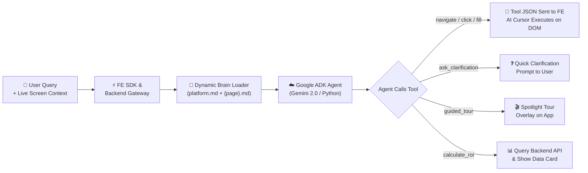
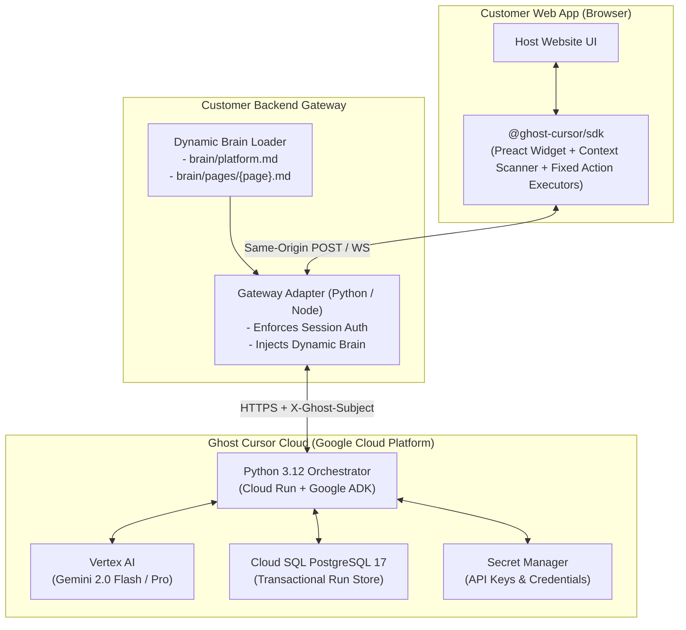

# 👻 Ghost Cursor — Hackathon Presentation (Slide-by-Slide)

---

## Slide 1: Brief About the Idea (Q1)

* **What is Ghost Cursor?**  
  A plug-and-play B2B SaaS platform that turns passive chatbots into **screen-aware autonomous co-pilots**.
* **Core Value Proposition:**  
  Traditional bots tell users what to do; Ghost Cursor **performs the actual task** on the user's screen in real-time.
* **How It Operates:**  
  1. Lightweight Frontend SDK (~5 lines) embeds an interactive chat widget and an in-browser executor.  
  2. Customer Backend Gateway SDK (~6 lines) automatically resolves dynamic page-specific business context (Brain) and routes requests.  
  3. Hosted Orchestrator (built in Python 3.12 with **Google Agent Development Kit (ADK)** & Gemini 2.0 on GCP) invokes fixed frontend action tools (`navigate`, `click`, `fill_input`).  
  4. An animated **Ghost Cursor** navigates, clicks, and fills forms directly on the customer's web app upon user approval.
* **Outcome:** Eliminates user drop-offs, reduces support tickets by up to 70%, and provides seamless guided onboarding.

---

## Slide 2: Opportunities & Market Differentiators (Q2)

* **How It Differs from Existing Tools:**  
  * *Traditional Bots (Intercom, Zendesk):* Only deliver static text/FAQs; cannot interact with the UI.  
  * *Digital Adoption Platforms (WalkMe, Pendo):* Rely on rigid, pre-recorded scripts; cannot reason dynamically.  
  * *Ghost Cursor:* Combines dynamic LLM reasoning + live DOM awareness + autonomous visual execution.
* **Problem Solved:**  
  Ends navigation drop-offs and complex form abandonment. Users avoid manual searching while businesses slash customer support overhead.
* **Unique Selling Proposition (USP):**  
  > **"Don't just explain the steps — execute them."**  
  * **Frontend Tools as Agent Tools:** The Google ADK Agent calls fixed frontend action tools; the SDK deterministically executes them.  
  * **Dynamic Business Brain:** Zero technical tags. The backend SDK dynamically pairs `platform.md` with `{page}.md` to supply pure business rules.  
  * **True Plug-and-Play Integration:** Zero redesign needed; embeds in ~11 lines of code across modern frameworks.

---

## Slide 3: List of Features Offered (Q3)

1. **🖥️ Screen-Aware Guidance:**  
   Inspects live DOM elements, form values, and routes to give hyper-accurate, page-specific answers instead of generic documentation.
2. **🎯 AI Cursor Auto-Actions:**  
   Fixed frontend execution tools (`navigate`, `click`, `fill_input`, `toggle_switch`) animate an on-screen cursor and execute tasks.
3. **❓ Smart Clarifying Questions:**  
   Detects missing inputs or ambiguities and prompts the user with quick-reply cards prior to executing sensitive steps.
4. **🎬 Guided Explainers:**  
   Renders dynamic spotlights, interactive tooltips, and narrated tours across the interface to onboard users.
5. **📊 Business Tools & ROI Insights:**  
   Directly queries customer APIs and analytics to provide live data, margin calculations, and interactive sensitivity cards.

---

## Slide 4: Process Flow & Use-Case Diagram (Q4)



* **Core Actors:** End-User (natural interaction, task delegation, approval gate) & Business Admin (branding, capabilities, Brain configuration).

---

## Slide 5: Wireframes / User Experience (Q5)

```
[1. Screen-Aware Chat]         [2. AI Cursor in Action]          [3. Smart Clarification]
┌────────────────────────┐     ┌────────────────────────┐        ┌────────────────────────┐
│ Context: Project Phoenix│    │ Setting: Appearance    │        │ Action Requires Input: │
│ Page:    Dashboard     │     │ Mode:    [Light] ➔ [🌙]│        │                        │
│                        │     │                ↑       │        │ 🤖 Would you like me   │
│ 🧑 "Turn the appearance│     │           👻 ──┘       │        │    to save this for all│
│    to dark mode"       │     │ (Ghost cursor clicks   │        │    workspaces?         │
│                        │     │  settings & toggles)   │        │ [📍 Current Only]      │
│ 🤖 "I will navigate to │     │                        │        │ [🌐 All Workspaces]    │
│ Settings & flip toggle"│     │ 🌙 [ Dark Mode Active ]│        │                        │
└────────────────────────┘     └────────────────────────┘        └────────────────────────┘
```

* Zero-friction modal overlays run within isolated **Shadow DOM**, ensuring the host app's styling never breaks.

---

## Slide 6: Architecture Diagram (Q6)



---

## Slide 7: Technologies Used (Q7)

* **Agentic Framework:** **Google Agent Development Kit (ADK)** in Python 3.12 for graph-based tool routing, function calling (`navigate`, `click`, `fill_input`), and human-in-the-loop approvals.
* **AI & LLM Engine:** Google Cloud Vertex AI (Gemini 2.0 Flash for sub-second action planning, Gemini 2.0 Pro for complex reasoning).
* **Cloud Infrastructure (GCP):**  
  * *Cloud Run:* Serverless container hosting with autoscaling (scale-to-zero when idle).  
  * *Cloud SQL (PostgreSQL 17):* Authoritative ACID multi-tenant run store with row-level revision locking.  
  * *Secret Manager & Cloud Armor:* Centralized credential management and edge WAF protection.  
  * *Cloud Storage + CDN:* Edge distribution for compiled SDK assets.
* **Backend Runtime:** Python 3.12, FastAPI (async WebSockets), Pydantic v2, PostgreSQL driver (`psycopg3`/`asyncpg`).
* **Frontend Core:** TypeScript, Preact (~3KB isolated Shadow DOM widget), Web Animations API, native DOM prototype dispatchers.

---

## Slide 8: Implementation & Infrastructure Cost (Q8)

* **Prototype Build Effort:**  
  * 48 hours / 3–4 developers across Frontend SDK, Python ADK Cloud Run Orchestrator, Customer Gateway, and Demo App.
* **GCP Infrastructure Cost (Prototype):**  
  * **~$5 – $15 total** (Cloud Run & Cloud SQL within low-tier budgets; costs driven almost entirely by Gemini token usage).
* **Production SaaS Unit Economics:**  
  * **~$0.005 – $0.01 per conversation** using Gemini 2.0 Flash context caching.  
  * High-margin B2B SaaS model ($299 to $999/month tiers).

---

## Slide 9: Future Scope & Roadmap (Q9)

* **Phase 1: Developer Ecosystem (1–3 Months)**  
  * Self-serve web console for tenant keys and private Brain management.  
  * Multi-agent hierarchies in Google ADK for parallel sub-workflows.  
  * Client-side action undo/rollback recording.
* **Phase 2: Multimodal & Accessibility (3–6 Months)**  
  * Visual perception using Gemini 2.0 Vision for canvas, WebGL, and complex non-DOM dashboards.  
  * Voice-driven input and live audio navigation via Web Speech API.
* **Phase 3: Enterprise Platform (6–12 Months)**  
  * 1-click turnkey integrations for Shopify, Salesforce, and WordPress.  
  * Dedicated enterprise VPC deployments with Bring Your Own Key (BYOK) encryption and SOC2 Type II compliance.
